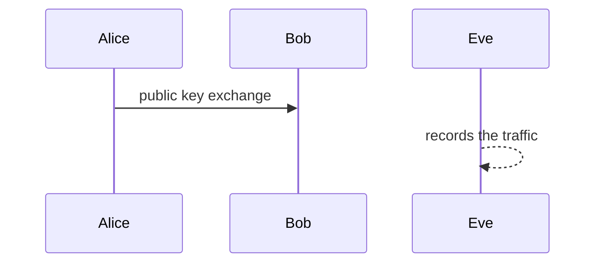

# Page Architecture

The fixed skeleton every Study OS page follows, plus the exact Notion markdown to produce it. Consistency is the point: a reader recognises the structure instantly across topics.

## The skeleton (in order)

1. **Meta callout** (gray): Last Updated, level, reading time, Related pages.
2. **Purpose callout** (blue): Page Purpose, Non-scope, Related Pages with a one-line difference each. **No signpost legend here:** the legend lives once, on the library home page (`notion-operations.md` -> "Library conventions").
3. **Hook**: one short paragraph that frames why the topic matters.
4. **Contents toggle**: the table of contents inside a collapsed toggle, never as a full-width block. Skip it on pages with fewer than four chapters.
5. **Concept map** (topic and hub pages): one small Mermaid diagram showing the parts of the topic and how they connect. It is the visual index; the reader sees the shape before the detail.
6. **Deep dives** (hubs only): the child-page cards under `## Deep dives`. The cards ARE the index; never add a table repeating their titles.
7. `# Page Topic`, a horizontal rule.
8. **Core chapters** as real `## H2` headings (H3 for sub-points), domain-agnostic (see "Core and verticals").
9. **Verticals** (when the topic has domain applications): `## Verticals` with one child-page card per domain.
10. **Closing block in columns**: Glossary in one column, Watch and Resources in the other; Sources full width below.

**Toggles are for minor content only:** answers to exercises, long tangents, raw data, extended derivations, full reference tables. Never wrap a whole chapter in a toggle.

## Core and verticals

A topic is studied once, then applied many times. Keep the two apart so the library scales.

- **Core page:** everything true regardless of industry. Physics, mechanism, standards, generic risk and mitigation. It mentions a domain only as an example, never as a chapter.
- **Vertical page:** one child page per domain where the topic has specific consequences (Bitcoin, finance and banking, hardware, defence, telco, healthcare). Title: `<Topic>: <Domain>` (for example `Quantum & Post-Quantum: Bitcoin`).
- **Vertical skeleton:** the standard meta and purpose callouts (Non-scope points back to the core), then `## Exposure` (what in this domain is affected and how much), `## Specific threats or opportunities`, `## State of play` (dated: proposals, projects, regulation), `## What to do` (a table by actor), closing block.
- **Indexing:** the core page lists verticals under `## Verticals` as cards with a one-line focus each. A domain hub elsewhere in the library (for example a Bitcoin page) links to its vertical with an inline mention, so the vertical is reachable from both sides.
- **When to split:** as soon as a domain needs more than two paragraphs. A vertical of one paragraph stays as an example inside the core.

## Use Notion's structure aggressively

A page of headings and bullets wastes the medium. Every chapter carries at least one visual element unless it is three lines long:

- **Tables** for comparisons, matrices, timelines, families (item / how it works / strength / weakness). Parallel bullets that share the same fields are a table.
- **Columns** (2 or 3) for parallel blocks of similar weight: before and after, two positions, physical vs logical, and the closing block.
- **Diagrams** (Mermaid) for every process, protocol, dependency or decision. Protocols and attacks use a `sequenceDiagram` with named actors: Alice and Bob for the honest parties, Eve for a passive eavesdropper, Mallory for an active attacker. Decisions use a flowchart. Topic overviews use a concept map.
- **Images** for what Mermaid cannot draw: a real photo, a hardware shot, a data chart. Found and uploaded, or generated and uploaded (`media-assets.md`). An image slot is the last resort.
- **Callouts** to make a key insight, warning or definition stand out.

## Links inside the words

Cite at the point of use: the words that carry the claim are the link. *NIST [finalized the first three standards in August 2024](url)*, not a bare statement with a footnote at the bottom. The Sources section still lists the main references, but the reader should never have to scroll to verify a sentence. Internal pages are mentions, not URLs.

## Signpost system

Inline bold labels, used consistently. The legend is on the library home page, not on each page.

- 💡 **Key idea:** the core insight in one or two lines.
- 💬 **Example:** a concrete, real example or mini-scenario, often numeric.
- 🧩 **Analogy:** a familiar comparison for an abstract or technical idea.
- 🔑 **Insight:** a sharp rule of thumb.
- ⚠️ **Watch out:** a common mistake, risk or misconception.
- 🧭 **Open question:** what is unsettled or at the frontier.
- 📚 **Go deeper:** a source or a deep-dive page.

## Chapter depth

A strong chapter has: a one-line hook, 💡 a key idea, the substance (table, columns, diagram, steps), 💬 a concrete or numeric example, ⚠️ a misconception where one exists, and a link to go deeper. Meaty topics add a 🧭 open question. The shape varies per chapter; never repeat one rigid template.

## Block syntax (Notion markdown, current)

Verified against the live connector. When unsure, fetch a well-formatted page and mirror its syntax; the connector's own spec is at `notion://docs/enhanced-markdown-spec`.

- **Bold, italic, links:** `**bold**` or `<b>bold</b>`, `*italic*`, `[descriptive words](https://url)`.
- **Page mention:** `<mention url="https://app.notion.com/p/PAGE_ID"/>` (renders the live title).
- **Date:** `<date start="2026-11-18" />`.
- **Child page card:** `<page url="https://app.notion.com/p/PAGE_ID">Title</page>`.
- **Table of contents:** `<table-of-contents color="gray" />`.
- **Image:** `<image source="file-upload://ID">Caption</image>` after an upload, or ``.
- **HTML embed (interactive tool):** `<embed source="file-upload://ID" />` after uploading an `.html` file.
- **Do not use** `<details>`, `<summary>`, `<div>` or other raw HTML: they are saved as literal text.

### Callouts
```
<callout color="gray_bg">
**Last Updated:** <date start="2026-11-18" /> • **Level:** intermediate • **Reading time:** ~20 min
**Related Pages:** <mention url="..."/> • <mention url="..."/>
</callout>

<callout icon="⚛️" color="blue_bg">
**Page Purpose:** what this page is and why it exists.
**Non-scope:** what it deliberately excludes, and where that lives.
**Related Pages:**

- <mention url="..."/>: relationship and difference.
</callout>
```
Colors: `gray_bg` neutral or meta, `blue_bg` insight or purpose, `green_bg` positive outcome, `yellow_bg` image slot or work to do.

### Contents toggle
```
<toggle>
**Contents**

<table-of-contents color="gray" />
</toggle>
```

### Toggle (minor content) and toggle heading
```
<toggle>
**Solutions**

- answer 1
</toggle>

<toggle heading="h3">
Full conjugation tables

table or list here
</toggle>
```
The title is the first line after the opening tag; children follow a blank line.

### Columns
```
<columns>
<column ratio="50">
### Pros

- ...
</column>
<column ratio="50">
### Cons

- ...
</column>
</columns>
```

### Tables
```
<table fit-page-width="true" header-row="true">
<tr><td>Dimension</td><td>Option A</td><td>Option B</td></tr>
<tr><td>**Cost**</td><td>...</td><td>...</td></tr>
</table>
```

### Mermaid
````

````
Quote node labels that contain punctuation. Avoid `->` arrows in normal text (they get escaped); write "then" or draw a diagram.

### Closing block
```
<columns>
<column ratio="50">
## Glossary

- **Term:** definition.
</column>
<column ratio="50">
## Watch

- [Video title](url)

## Resources

- [Resource title](url)
</column>
</columns>

## Sources

- [Title, Month Year](url)
```

## Standard page template

```
[meta callout]
[purpose callout]

[hook paragraph]

<toggle>
**Contents**

<table-of-contents color="gray" />
</toggle>

[concept map: mermaid]

# [Page Topic]

---

## [Chapter]

[one-line hook]

💡 **Key idea:** [core insight]

[table / columns / diagram]

💬 **Example:** [concrete case, with an inline [linked source](url)]

## Verticals

One page per domain where the topic has specific consequences.

<page url="...">[Topic]: [Domain]</page>

[closing block]
```

## Notes on chapters

- Chapters are headings, not toggles. Vary the internal shape per chapter.
- Reserve toggles for minor or appendix content. Do not deep-nest toggles.
- After a `<page>` card, start the next block with a heading or a paragraph, never a bare list item.
