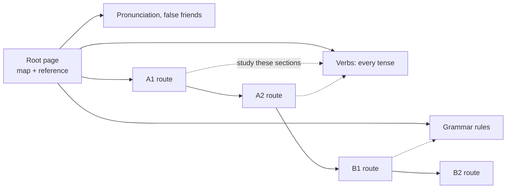

# Page Types

One skill, three page types. The skeleton in `page-architecture.md` (meta callout, purpose callout, hook, chapters as headings, Glossary / Resources / Sources) applies to all of them. The type decides which chapters exist and what goes in them. These templates replace any platform template (Notion database templates, Confluence blueprints): the structure lives here, so it travels with the skill.

## Choosing the type

| Signal | Type |
| --- | --- |
| A concept, field, technology, method, market | **Topic** (default) |
| A book title, an author, a row in a book database, "riassunto", "summary of" | **Book summary** |
| A language name, "da zero a B2", a CEFR level, grammar, vocabulary, conjugations | **Language course** |

If the database itself is typed (a Book Library, a Languages section), the database decides. A hybrid (a book about a topic the library lacks) is a book summary that links to a topic page, never both in one page.

---

## Topic (default)

Use the standard architecture as written in `page-architecture.md`. Hubs get sub-page cards under `## Deep dives`; deep dives aim at real competence (`research-protocol.md` -> "Depth bar").

Split **core and verticals** (`page-architecture.md` -> "Core and verticals"): the core page is domain-agnostic; each domain where the topic has specific consequences gets its own vertical child page under `## Verticals`. A deep dive goes deeper into a part of the core; a vertical applies the whole core to one industry.

---

## Book summary

The goal is not to retell the book. It is to keep what changes how the reader thinks or acts, in a form that can be reread in ten minutes.

**Chapters, in order:**

1. **Card** (a 2-column block or a small table right after the purpose callout): author with one line on why they are credible, year, category, length (pages or audio hours), **In one sentence** (the thesis), **Read it if / Skip it if**.
2. `## The thesis in 60 seconds`: 3 to 5 bullets. The argument, not the table of contents.
3. `## Big ideas`: 3 to 7 ideas, each as an `### H3` with 💡 the idea, the mechanism or evidence the author gives, 💬 the book's own example (or a better real one), 🔑 how to apply it. Organise by idea, not by chapter: ideas are what gets remembered.
4. `## Chapter by chapter`: one short block per chapter: the chapter title in bold, 2 to 4 sentences of context (what problem the chapter addresses, the argument, the story or evidence that carries it), then a **Keep:** line. A one-line table loses the reasoning that makes the idea stick; a full retelling loses the point. For very long books (20+ chapters) group chapters by part.
5. `## Frameworks and models`: every named framework as a Mermaid diagram or a table. Skip the chapter if the book has none.
6. `## Quotes`: at most 5, verbatim, short (one or two sentences), each with chapter or page. Verify every quote with a search; an unverified quote is cut, never paraphrased into quotation marks.
7. `## Apply it`: a checklist of concrete actions. If the user's context is known (role, company, goals), tailor the actions to it.
8. `## Critiques and limits`: what the evidence does not support, what aged badly (dated), the strongest counter-argument, and the book that makes it.
9. `## Related`: other pages and books in the library (`<mention url>`), plus one counterpoint book.

**Rules specific to books:**
- Summaries are in your own words. Never reproduce passages beyond the short quotes above.
- Sources: the publisher or author page, one serious review or critique, and a research source for any empirical claim the book makes.
- Database row: map author, year, category, language and a one-line description (the thesis) from the live schema. The reader's own state (read, listened, personal rating, owned formats) is **personal state**: never set or change it.

---

## Language course

Two kinds of content, two places. **Reference** content is complete regardless of level: every verb tense, every grammar rule, pronunciation, false friends. It lives **centrally on the root page**, never split across level pages, so one topic is always in one place. **Route** content is sequential: what to study at each level, can-do goals, level vocabulary, exercises, the exam. It lives in one sub-page per CEFR level, and points into the reference instead of repeating it.

**Root page chapters:**
1. `## The map`: a table, `Level | Can do (short CEFR descriptor) | Grammar milestones | Active vocabulary | Guided hours`. Hours and descriptors from an official source (Council of Europe CEFR, the language's exam body, Cambridge guided learning hours), dated.
2. `## Route`: the level sub-page cards, in order, with one line each on what the level unlocks.
3. `## How this language works`: the 5 to 8 structural facts that explain most of the grammar (gender, cases, verb system, word order, pronunciation), each contrasted with the learner's native language.
4. `## Verbs: every tense`: one overview table `Tense | Level | When to use it | Regular forms (3 conjugations) | Native-language equivalent`, then one `<toggle heading="h3">` per tense with the full conjugation table, the main irregulars and 3 example sentences. Every tense in one place, tagged with the level where it is introduced.
5. `## Grammar reference`: one `<toggle heading="h3">` per topic (articles, pronouns, the copula distinctions, the subjunctive and its triggers, conditionals, reported speech, prepositions), each complete, each tagged with its level.
6. `## Pronunciation and spelling`: sounds absent from the native language, stress and accent rules, minimal pairs, an audio link.
7. `## False friends and typical mistakes`: one table each, against the learner's native language.
8. `## Study plan and exams`: a weekly routine table and the official exam per level with what it tests.
9. Closing block: Resources (table `Resource | Type | Level | Why`) in columns with Watch, then Sources.

**Level page (route) chapters:**
1. `## Can-do goals`: the CEFR descriptors for this level as a checklist.
2. `## What to study`: a table `Topic | Reference section | Done`, linking to the root page sections (verbs and grammar introduced at this level). No grammar is restated here beyond a one-line reminder.
3. `## Vocabulary by theme`: tables `Word | Translation | Example | Note`, frequency first. Vocabulary is level-specific, so it lives here.
4. `## Phrases for real situations`: tables per situation at this level.
5. `## Practice`: exercises; **answers in a toggle**.
6. `## Checkpoint`: a self-test and the matching exam section.

**Rules specific to languages:**
- The learner's native language drives every contrast (false friends, typical mistakes, pronunciation). Read it from the page language or the user's profile; ask only if neither tells you.
- Long reference tables (full conjugations of irregular verbs) go in a toggle heading inside their reference chapter, not in the flow.
- A level page that starts repeating grammar is a sign the reference is incomplete: fix the reference, then link to it.
- Curiosities belong only if they help memory (an etymology that explains a spelling, a cultural rule that changes register). Otherwise cut them.
